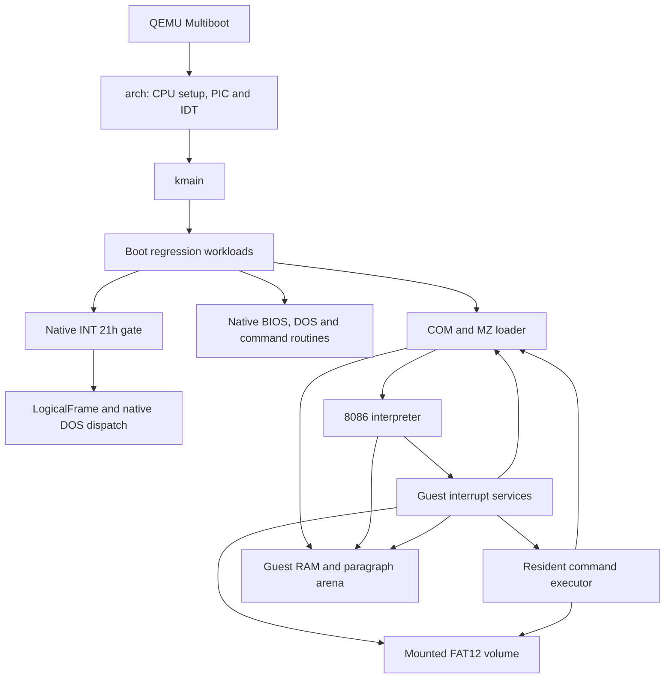

# DOS-RS architecture

DOS-RS builds one Rust 2024 `no_std` binary for each of two bare-metal targets. Architecture-specific code enters a kernel in protected mode on i686 or long mode on x86_64. Both binaries run DOS executables with the same interpreter and 20-bit address space. Boot executes a fixed set of native and interpreted workloads and prints their results on COM1.

## Boot and native interrupts

The Multiboot header, entry assembly and linker script place the kernel at 1 MiB. The x86_64 entry builds an identity map and enables long mode. Native setup masks both PICs and installs the INT 21h gate. `kmain` prints the target banner, calls the smoke workloads and exits through port `0xF4`. Native device and command demonstrations call the translated Rust routines. The boot probe also executes the CPU's actual `int 0x21` instruction. [Kernel entry](src/main.rs) · [Architecture code](src/arch.rs) · [Boot workloads](src/smoke.rs)

The gate saves the native register image, clears the direction flag for Rust, aligns the call stack and maps the DOS registers to a `LogicalFrame`. Only the gate can construct its entry token. The native dispatch table covers AH through `6Ch`, with default handlers for unimplemented slots. Word results replace the low 16 bits. The interrupted flags stay in the CPU return frame until `iret`. Native services that accept pointers operate on kernel addresses. [Native INT 21h dispatcher](src/int21.rs)

## Interpreted execution and the DOS ABI

`CpuState` holds the guest general registers, segment registers, IP and FLAGS. The decoder updates IP and yields an interrupt, halt or fault to the run loop. The run loop dispatches modeled BIOS services, DOS INT 21h and the resident command executor at INT 2Eh. Other supported guest vectors can transfer control to a guest handler. Guest pointers are segment–offset addresses resolved through guest RAM. [CPU state](src/guest/state.rs) · [Instruction decoder](src/guest/step.rs) · [Run loop and services](src/guest/run.rs)

Both version handlers read the same three DOS words. AH=30h ignores AL, returns AX=0004h, BX=FF00h and CX=0000h, and preserves the incoming carry. Native and guest register adapters apply these writes within their own address and flag models. Other services have different levels of implementation across the two entry paths. [Version contract](src/dos/getset.rs) · [Guest ABI regression](tests/architecture.asm)

## Memory and program loading

A guest address maps to `((segment << 4) + offset) & 0xFFFFF` in one 1 MiB buffer. Fetches and data loads read the same byte, including immediately after a write through an alias. Conventional memory ends at paragraph `A000h`. Low memory holds the DOS service tables. The remaining upper addresses participate in real-mode address arithmetic. [Guest RAM](src/guest/memory.rs)

The arena maintains sorted, non-overlapping paragraph ranges with a PSP owner and an exclusive end. Process placement reserves the environment and program blocks together. DOS heap allocation searches the gaps starting at paragraph `0C00h`; live program blocks and allocations take precedence over that search floor. AH=48h applies the selected first, best or last fit. AH=49h validates the block start and ownership. AH=4Ah can shrink a block or grow it into the following gap. An oversized request returns DOS error 8 and the available paragraph count in BX. The arena records up to 128 occupied ranges in kernel memory. Applications that walk guest-visible DOS MCB headers require additional support. [Paragraph arena](src/guest/arena.rs)

The boot runner, shell and EXEC use one loader. The PSP records the granted end segment at 02h, parent at 16h, private environment at 2Ch and command tail at 80h. A COM image starts at offset 0100h, with its initial stack inside the granted block. Ordinary COM programs receive a 64 KiB segment. The bundled resident shell uses a smaller block so it can launch children. MZ loading checks the declared file length, header, entry, relocation table and relocation targets before reserving memory. It uses the declared load module, honors the minimum allocation and initial stack, grants available extra memory up to the requested size or the space required for the initial stack, and adds the load segment to each relocation word. Bytes appended as overlays stay out of the initial load. [Process loader](src/guest/process.rs) · [MZ parser](src/guest/mz.rs)

A synchronous EXEC suspends the parent CPU. The child starts with its own PSP, a private copy of the environment variables, and a default disk transfer area at PSP:0080h. On return the runtime restores the parent PSP and transfer address, reclaims the child's ranges, and makes its exit code available through AH=4Dh. The return path also runs on an interpreter fault or instruction-budget exhaustion. The session retains shared DOS service state and the open-file buffers. Full DOS job and system file table inheritance is still partial. The 64 KiB native boot stack supports a bounded chain of eight interpreter child calls. [EXEC and process lifecycle](src/guest/run.rs)

## Devices, volumes and commands

| Component | Runtime responsibility |
| --- | --- |
| Native BIOS, DOS and command modules | Implement selected upstream device requests, filesystem operations, process routines and commands. The boot workloads drive individual translations and check serial results. |
| `disks/msload.img` | The native BIOS and SYSINIT/MSLOAD workload uses the boot fixture. The harness also attaches it to QEMU as a floppy. |
| `disks/guest12.img` | Templates the guest FAT12 volume. Each `disk::boot()` in the boot workload starts a fresh in-memory copy. DOS AH=0Dh flushes open files. |
| Guest disk services | DOS file operations, executable lookup and guest BIOS sector reads use the mounted bytes. File replacement stages the FAT until the whole chain fits. Created and closed programs can be executed immediately. Mutations last for the mounted session. |
| Guest command executor | The bundled COMMAND.COM reads AUTOEXEC.BAT and passes commands through INT 2Eh. Built-ins use the mounted volume. External programs enter the common loader. |

The current guest storage implementation targets the supplied 512-byte-sector FAT12 disk with one sector per cluster. File handles, transfers, writable file sizes and interpreter instruction counts are bounded. The serial console and scripted batch exercise specific compatibility paths. An interactive shell, arbitrary disk geometry and complete MS-DOS 4.0 compatibility remain outside the verified surface. [BIOS modules](src/bios.rs) · [Guest disk](src/guest/disk.rs) · [Guest command executor](src/guest/command.rs)

## Verification and source coverage

The host tests exercise both allocators, ownership, resize boundaries, loader failure atomicity, MZ relocation, excluded overlay bytes, PSP tail bounds and failed replacement on a full FAT volume. The QEMU suite boots both targets and checks native carry preservation, real guest program output and file artifacts produced inside DOS. The architecture probe modifies a future instruction through a segment alias, creates a COM on the mounted volume, executes it through INT 21h, checks parent memory and DTA restoration, and unwinds a nested EXEC chain. [Host tests](tests/layout.rs) · [QEMU harness](scripts/qemu-smoke.sh) · [Guest workload driver](src/guest/run/smoke.rs)

The translation checklist is keyed by upstream paths at the revision identified in NOTICE. Native Rust translations, interpreted upstream binaries and synthetic regression programs provide different kinds of coverage. A tool executing from the guest disk demonstrates the exercised DOS services and opcodes. Translation status belongs to its individual checklist row. [Checklist](checklist/v4.0.tsv) · [Guest program observations](docs/guest-programs.md) · [Upstream source](NOTICE)
