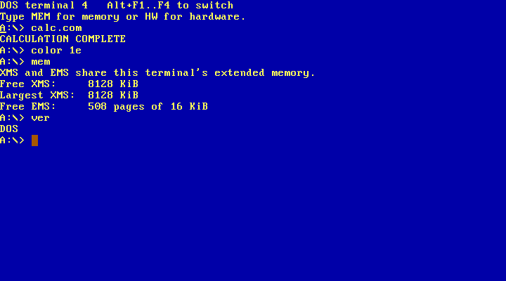
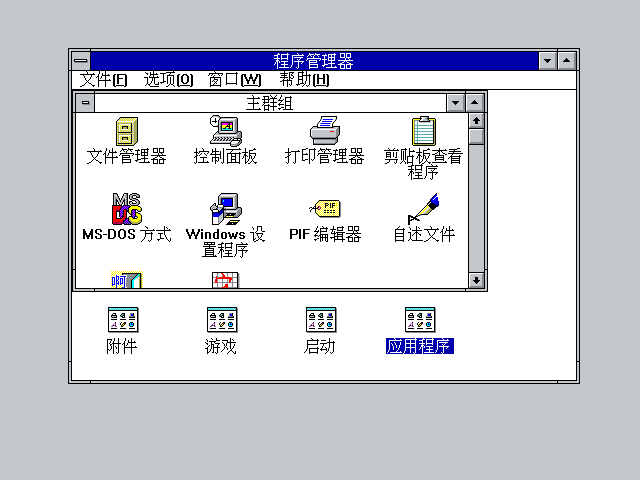

# DOS

DOS 是用 Rust 实现的操作系统。80286 和 80386 可以从同一张 BIOS 软盘启动原生 16 位内核。i686 与 x86_64 使用支持多会话的内核。在多会话内核中，按 **Alt+F1 ～ Alt+F4** 切换四个 DOS 终端。在一个终端等待键盘时，另一个终端仍可运行编译器，两者能通过 A 盘交换文件。



## 在 286 或 386 上原生启动

引导程序检查 CPU 的 FLAGS，从 A 盘载入 `K286.SYS` 或 `K386.SYS`。实模式应用直接使用 CPU 执行，Shell 可加载 COM 与 MZ EXE，处理 PSP、命令行、重定位和 INT 21h。系统名为 **DOS**。版本查询默认报告兼容版本 7.10。AH=30h 在 AX 中返回 0A07h，AX=3306h 在 BX 中返回 0A07h。

构建需要 mtools 和已经构建的 rust16 工具链。工具链在链接时自动加入实模式启动入口和 BIOS 调用代码，生成的启动盘可独立使用。下面的命令假定工具链位于相邻目录，RAM 盘上已有数据盘 `c.img`。[本次验证的 rust16 版本和构建步骤](https://github.com/JamesLinYJ/rust16/tree/34ea49274a0b6ff729dcf96a07b6ff0b21f8ee62)

```sh
python3 scripts/realmode-image.py --toolchain ../rust16 --output "$RAM_DISK/dos.img"
qemu-system-i386 -boot a -drive "if=floppy,format=raw,readonly=on,file=$RAM_DISK/dos.img" \
  -drive "if=ide,format=raw,file=$RAM_DISK/c.img"
```

A 盘是 1.44 MiB FAT12 启动软盘。已有 FAT16 或 FAT32 镜像可以作为 C 盘。原生内核支持 512 字节扇区、裸卷和 MBR 主分区、8.3 文件名、子目录及跨簇读写。`C:`、`DIR`、`CD`、`TYPE` 和 `COPY` 直接操作该卷。DOS 文件句柄支持打开、读取、定位、创建、写入与关闭。原生版当前同时运行一个前台程序，单个 COM/MZ 文件受近段大小限制。可同时打开一个可写句柄，写入暂存区上限为 65,024 字节。`COPY` 在同一 C 盘内逐扇区复制，可跨过 64 KiB。

```sh
python3 scripts/realmode-test.py --toolchain ../rust16 --ram-dir "$RAM_DISK"
```

这项回归需要 DOSBox-X、QEMU、NASM、mtools 和 dosfstools。它用 286 与 386 CPU 模型启动同一张软盘，再通过两个 QEMU 系统模拟器输入命令。FAT32 根目录在第 66536 簇，测试文件从第 68001 簇开始。每次关机后用 mtools 读回文件，核对 100 KiB 文件的内容，并运行 `fsck.fat -n`。测试还覆盖 MBR 分区和每簇含两个扇区的 FAT16 卷。下文的 Windows 3.2、多核和多终端验收适用于 i686 和 x86_64 内核。

## 在 QEMU 里启动 i686 和 x86_64 内核

需要 Python 3、Rustup、NASM、mtools、QEMU，以及仓库指定的 Rust nightly。UEFI 启动还需要对应架构的 OVMF 固件。macOS 可用 Homebrew 安装 qemu、mtools、nasm 和 coreutils。

```sh
python3 scripts/prepare-cpu.py
python3 scripts/qemu.py --arch x86_64 --firmware uefi
python3 scripts/qemu.py --arch i686 --firmware bios
```

两条启动命令都打开 QEMU 图形窗口，默认使用四颗虚拟 CPU。两个架构均支持两种固件。Mac 键盘用 Option 代替 Alt。如需换用自己的 FAT 启动卷，将含有 DOS-RS 驻留 COMMAND.COM 的镜像通过 `--image /path/to/dos.img` 传入。每个终端先加载 CONFIG.SYS 中的设备，再执行 AUTOEXEC.BAT。

## 在提示符下试试

| 命令 | 可以看到什么 |
| --- | --- |
| `COLOR 1E`、`VER` | 黄字蓝底的系统名。本终端保留配色，`COLOR` 恢复默认。 |
| `MEM` | 查看本终端空闲的 XMS、最大连续块和可映射的 EMS 页数。若当前目录有 FreeDOS MEM，则运行磁盘上的程序。 |
| `HW` | 每颗在线 CPU 的 APIC ID、客体时间片计数和 PCI 设备。 |
| `USB`、`USB READ 7` | 连接速度、设备 ID 和 USB 大容量存储第 7 个扇区的前 32 字节。 |
| `NET`、`NET ARP 10.0.2.15 10.0.2.2` | 在挂有 e1000 的 QEMU 用户网络中，读出网卡地址并实际收发 ARP 帧。 |
| `WIFI`、`BT` | Intel 无线适配器探测信息、标准 USB 蓝牙控制器状态或缺少设备的原因。 |

## 兼容范围

**启动和并发**　传统 BIOS 从 MBR 启动，UEFI 从系统分区加载。二者进入同一套内核服务。启动 CPU 管理设备，其他 CPU 用独立栈并行执行不同会话的解释器时间片。单 CPU 自动回退到轮转。项目自有引导和内核源码使用 Rust。底层的 MBR 入口、实模式转换、AP 启动和中断门使用固定版本的外部架构代码。[外部组件说明](NOTICE)

**i686 和 x86_64 怎样执行 16 位程序**　这两个内核使用 DOS-RS 自己的 Rust 指令解释器。每个会话有独立的寄存器、内存和设备状态。开启 `--pc386` 后，标准模式使用 Windows 的 DOSX。386 增强模式由 Windows 自己的 VMM 管理页表、保护模式任务和虚拟 8086 上下文，DOS-RS 按客体寄存器翻译地址、递交异常和中断。VGA 位平面绘图和 AT 键盘中断也由 DOS-RS 实现。宿主上的 QEMU 负责启动整台虚拟 PC。[执行器源码](src/guest/step.rs)

**DOS 程序和内存**　支持实模式 COM 和 MZ、嵌套 EXEC、MCB、每进程 JFT、共享文件偏移和驻留 DOS 驱动。每个终端有 640 KiB 常规内存，默认配 8 MiB 扩展内存。启动时可用 `--extended-mib 128` 为每个会话配置 128 MiB，直接构建可用 `DOS_RS_EXT_MIB` 指定 1～128 MiB。128 MiB 配置为高端内存区预留 64 KiB，XMS 和 EMS 共同分配余下的 131,008 KiB。XMS 支持句柄、搬移、锁定、调整大小、HMA 和 A20。DOS 与 XMS 共用 96 KiB 上位内存区（UMB），程序可通过 INT 21h 链接上位内存，CONFIG.SYS 可用 `DEVICEHIGH` 装载驱动。EMS 通过 INT 67h 提供 D000 段的四个 16 KiB 窗口、七组备用映射寄存器、跨页搬移、交换和映射调用。当前虚拟 EMS 设备没有 DMA 寄存器组。FreeDOS MEM 1.12 的 /XMS 与 /EMS 已在双架构、双固件运行。[FreeDOS MEM](https://www.ibiblio.org/pub/micro/pc-stuff/freedos/files/repositories/1.4/html/en/base/mem/20250410.0/index.html)

**显示和设备**　UEFI 用 GOP 帧缓冲绘制彩色文本，BIOS 默认用 VGA 文本模式。开启 `--pc386` 后，传统 BIOS 也可在 QEMU 标准 VGA 上使用 640×480 图形模式。两条路径都支持 DOS 字符属性和终端切换。已验证 PS/2、串口、打印、IDE 扇区读取、FreeDOS SETVER.SYS、DOS 字符及块设备、xHCI 上的 USB 2.0 高速存储，以及 Intel 82540EM 的以太网帧收发。Intel 8265、AX200 和 AX210 目前实现 PCI 探测，固件加载和联网仍待完成。蓝牙已有 USB HCI 控制命令和 LE 扫描路径，待实物验证。

## 在内存 C 盘安装中文版 Windows 3.2

以下 macOS 示例使用已挂载的内存盘 `/Volumes/DOSRS-RAM`。启动介质、UEFI 变量和可写 C 盘都放在该卷上。只需创建一次 C 盘，关闭 QEMU 后复用同一镜像即可。卸载内存盘或重启 Mac 会丢失该卷内容。

```sh
RAM_DIR=/Volumes/DOSRS-RAM
C_IMG="$RAM_DIR/dos-c.img"
qemu-img create -f raw "$C_IMG" 64M
mformat -i "$C_IMG" -v DOSRS_C ::
mmd -i "$C_IMG" ::WINSETUP
# 将原版简体中文 Windows 3.2 安装盘的文件放入本地 winsetup 目录后执行
mcopy -i "$C_IMG" winsetup/* ::WINSETUP/
python3 scripts/qemu.py --arch x86_64 --pc386 --ram-dir "$RAM_DIR" --c-disk "$C_IMG"
```

在 DOS-RS 提示符依次输入 `C:`、`CD \WINSETUP`、`SETUP.EXE`。A 盘是内置的临时启动卷，C 盘是 IDE 主盘上的裸 FAT 卷，支持 512 字节扇区，当前整卷上限为 64 MiB。普通文件支持按偏移读写，关闭文件时将改动写回镜像。安装测试不附带 Microsoft 安装介质。

原版简体中文 Windows 3.2 已在 x86_64 和 i686 DOS-RS 上分别从空白 C 盘完成安装。选择 Express Setup 并输入姓名。安装器询问如何更新 A 盘配置时，选择将建议的配置保存到 Windows 目录。打印机选“无连接的打印机”，跳过教程。看到“Windows 3.2 已安装完毕”后选择返回 MS-DOS。

关闭 QEMU，用同一条启动命令和同一块 C 盘重新开机，在 DOS-RS 提示符输入以下命令：

```dos
C:
CD \WINDOWS
WIN /3
```

i686 / 传统 BIOS 和 x86_64 / UEFI 均已用内存 C 盘冷启动。进入中文程序管理器后，按 `Alt+H`、`A` 打开“关于程序管理器”。Windows 3.2 在两台机器上均显示“386 增强方式”。[i686 截图](docs/assets/windows32-enhanced-i686.png) · [x86_64 截图](docs/assets/windows32-enhanced-x86_64.png)

运行 `WIN /S` 可启动标准模式。两个架构也已在该模式下验证 640×480、16 色 VGA、键盘和计算器。NTFS 系统卷写入仍待验收。[验收记录](docs/guest-programs.md#windows-32-simplified-chinese)



## 运行回归

```sh
PROOF_DIR=target/proof-uefi scripts/qemu-smoke.sh
PROOF_DIR=target/proof-pc386 scripts/qemu-smoke.sh --pc386
DOS_RS_TEST_FIRMWARE=bios PROOF_DIR=target/proof-bios scripts/qemu-smoke.sh
python3 scripts/qemu-terminals.py
python3 scripts/qemu-terminals.py --firmware bios --output target/terminal-bios
python3 scripts/qemu-devices.py --setver /path/to/SETVER.SYS
python3 scripts/qemu-hardware.py
python3 scripts/qemu-memory.py --extended-mib 128 --mem /path/to/MEM.EXE
python3 scripts/qemu-native-gate.py
```

省略外部二进制参数即可运行仓库自带的测试。内核自测与交互启动独立。MASM、LINK、Microsoft C 等工作负载的输入和输出见[程序记录](docs/guest-programs.md)。修改模块和新增驱动的入口见[开发指南](AGENTS.md)。
