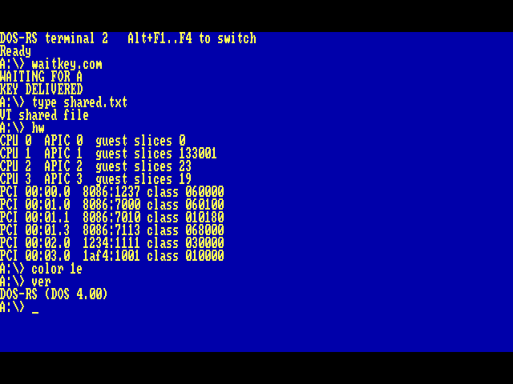

# DOS-RS

DOS-RS 在 i686 和 x86_64 上启动自己的 Rust 内核。按 **Alt+F1 ～ Alt+F4** 切换四个 DOS 终端。在一个终端等待键盘时，另一个终端仍可运行编译器，两者能通过 A 盘交换文件。



## 在 QEMU 里启动

需要 Python 3、Rustup、NASM、mtools、QEMU，以及仓库指定的 Rust nightly。UEFI 启动还需要对应架构的 OVMF 固件。macOS 可用 Homebrew 安装 qemu、mtools、nasm 和 coreutils。

```sh
python3 scripts/prepare-cpu.py
python3 scripts/qemu.py --arch x86_64 --firmware uefi
python3 scripts/qemu.py --arch i686 --firmware bios
```

两条启动命令都打开 QEMU 图形窗口，默认使用四颗虚拟 CPU。两个架构均支持两种固件。Mac 键盘用 Option 代替 Alt。如需换用自己的 FAT 启动卷，将含有 DOS-RS 驻留 COMMAND.COM 的镜像通过 `--image /path/to/dos.img` 传入。每个终端先加载 CONFIG.SYS 中的设备，再执行 AUTOEXEC.BAT。

## 在提示符下试试

| 命令 | 可以看到什么 |
| --- | --- |
| `COLOR 1E`、`VER` | 黄字蓝底的版本信息。本终端保留配色，`COLOR` 恢复默认。 |
| `MEM` | 查看本终端空闲的 XMS、最大连续块和可映射的 EMS 页数。若当前目录有 FreeDOS MEM，则运行磁盘上的程序。 |
| `HW` | 每颗在线 CPU 的 APIC ID、客体时间片计数和 PCI 设备。 |
| `USB`、`USB READ 7` | 连接速度、设备 ID 和 USB 大容量存储第 7 个扇区的前 32 字节。 |
| `NET`、`NET ARP 10.0.2.15 10.0.2.2` | 在挂有 e1000 的 QEMU 用户网络中，读出网卡地址并实际收发 ARP 帧。 |
| `WIFI`、`BT` | Intel 无线适配器探测信息、标准 USB 蓝牙控制器状态或缺少设备的原因。 |

## 兼容范围

**启动和并发**　传统 BIOS 从 MBR 启动，UEFI 从系统分区加载。二者进入同一套内核服务。启动 CPU 管理设备，其他 CPU 用独立栈并行执行不同会话的解释器时间片。单 CPU 自动回退到轮转。项目自有引导和内核源码使用 Rust。底层的 MBR 入口、实模式转换、AP 启动和中断门使用固定版本的外部架构代码。[外部组件说明](NOTICE)

**DOS 程序和内存**　支持实模式 COM 和 MZ、嵌套 EXEC、MCB、每进程 JFT、共享文件偏移和驻留 DOS 驱动。每个终端有 640 KiB 常规内存，默认配 8 MiB 扩展内存。启动时可用 `--extended-mib 128` 为每个会话配置 128 MiB，直接构建可用 `DOS_RS_EXT_MIB` 指定 1～128 MiB。128 MiB 配置为高端内存区预留 64 KiB，XMS 和 EMS 共同分配余下的 131,008 KiB。XMS 支持句柄、搬移、锁定、调整大小、HMA 和 A20。DOS 与 XMS 共用 96 KiB 上位内存区（UMB），程序可通过 INT 21h 链接上位内存，CONFIG.SYS 可用 `DEVICEHIGH` 装载驱动。EMS 通过 INT 67h 提供 D000 段的四个 16 KiB 窗口、七组备用映射寄存器、跨页搬移、交换和映射调用。当前虚拟 EMS 设备没有 DMA 寄存器组。FreeDOS MEM 1.12 的 /XMS 与 /EMS 已在双架构、双固件运行。[FreeDOS MEM](https://www.ibiblio.org/pub/micro/pc-stuff/freedos/files/repositories/1.4/html/en/base/mem/20250410.0/index.html)

**显示和设备**　UEFI 用 GOP 帧缓冲绘制彩色文本，BIOS 默认用 VGA 文本模式。开启 `--pc386` 后，传统 BIOS 也可在 QEMU 标准 VGA 上使用 640×480 图形模式。两条路径都支持 DOS 字符属性和终端切换。已验证 PS/2、串口、打印、IDE 扇区读取、FreeDOS SETVER.SYS、DOS 字符及块设备、xHCI 上的 USB 2.0 高速存储，以及 Intel 82540EM 的以太网帧收发。Intel 8265、AX200 和 AX210 目前实现 PCI 探测，固件加载和联网仍待完成。蓝牙已有 USB HCI 控制命令和 LE 扫描路径，待实物验证。

## 用持久 C 盘运行 Windows 安装程序

以下 macOS 示例使用已挂载的内存盘 `/Volumes/DOSRS-RAM`。启动介质、UEFI 变量和可写 C 盘都放在该卷上。只需创建一次 C 盘，关闭 QEMU 后复用同一镜像即可。卸载内存盘或重启 Mac 会丢失该卷内容。

```sh
RAM_DIR=/Volumes/DOSRS-RAM
C_IMG="$RAM_DIR/dos-c.img"
qemu-img create -f raw "$C_IMG" 64M
mformat -i "$C_IMG" -v DOSRS_C ::
mmd -i "$C_IMG" ::WINSETUP
# 将原版简体中文 Windows 3.2 安装盘的文件放入本地 winsetup 目录后执行
mcopy -i "$C_IMG" winsetup/* ::WINSETUP/
python3 scripts/qemu.py --arch x86_64 --pc386 --ram-dir "$RAM_DIR" --c-disk "$C_IMG"
```

在 DOS-RS 提示符依次输入 `C:`、`CD \WINSETUP`、`SETUP.EXE`。A 盘是内置的临时启动卷，C 盘是 IDE 主盘上的裸 FAT 卷，支持 512 字节扇区，当前整卷上限为 64 MiB。普通文件支持按偏移读写，关闭文件时将改动写回镜像。安装测试不附带 Microsoft 安装介质。

`--pc386` 启用保护模式解释器与会话独立的 VGA 平面显存。原版 SETUP 的彩色文本欢迎页已在 i686 和 x86_64 上验证，图形阶段可以用 Windows 自带的显示驱动绘出中文姓名对话框。完整安装、冷启动进入中文程序管理器及 NTFS 写入仍待验收。

## 运行回归

```sh
PROOF_DIR=target/proof-uefi scripts/qemu-smoke.sh
DOS_RS_TEST_FIRMWARE=bios PROOF_DIR=target/proof-bios scripts/qemu-smoke.sh
python3 scripts/qemu-terminals.py
python3 scripts/qemu-terminals.py --firmware bios --output target/terminal-bios
python3 scripts/qemu-devices.py --setver /path/to/SETVER.SYS
python3 scripts/qemu-hardware.py
python3 scripts/qemu-memory.py --extended-mib 128 --mem /path/to/MEM.EXE
python3 scripts/qemu-native-gate.py
```

省略外部二进制参数即可运行仓库自带的测试。内核自测与交互启动独立。MASM、LINK、Microsoft C 等工作负载的输入和输出见[程序记录](docs/guest-programs.md)。修改模块和新增驱动的入口见[开发指南](AGENTS.md)。
