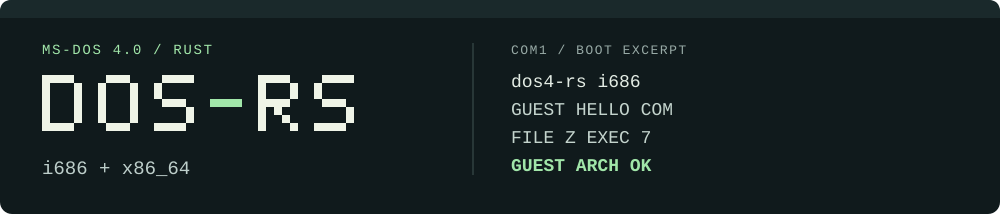

# DOS-RS



DOS-RS runs 16-bit DOS programs on two bare-metal Rust kernels. Boot either target in QEMU and the same interpreter runs COM and MZ executables against a writable FAT12 volume. The bundled workload assembles, compiles and links DOS programs, then executes the files it produced.

[Quick start](#quick-start) · [What runs](#what-runs) · [Contributor guide](AGENTS.md)

<details>
<summary>中文简介</summary>

DOS-RS 用 Rust 实现了部分 MS-DOS 4.0 服务。i686 和 x86_64 两个内核共用 16 位解释器。启动后，预设批处理会运行 MASM、LINK 和 Microsoft C 编译工具，并执行生成的 DOS 程序。下方命令可以构建两个内核、运行 QEMU 验证并保存串口记录。

</details>

## Quick start

From the repository root, use a shell with **rustup**, **Bash**, **QEMU** (`qemu-system-i386` and `qemu-system-x86_64`) and **`timeout`** on the path. Rustup reads the pinned nightly and components from [rust-toolchain.toml](rust-toolchain.toml).

```bash
cargo build -Zjson-target-spec --target ./i686-unknown-none.json --release
cargo build --target x86_64-unknown-none --release
PROOF_DIR=target/proof scripts/qemu-smoke.sh
```

The last command runs the host tests, boots each kernel and checks its serial output. A passing run prints `GUEST ARCH OK` for each target and returns **0**. The raw QEMU status is **33**, the success value from the debug-exit device. Open `target/proof/i686.txt` or `target/proof/x86_64.txt` to read a boot transcript.

On macOS, open the batch in QEMU’s serial console window. The console build uses its own output directory so the smoke commands above can reuse their release binaries.

```bash
cargo build --release --features batch-console --target x86_64-unknown-none --target-dir target/console
qemu-system-x86_64 -kernel target/console/x86_64-unknown-none/release/dos4-rs \
  -display cocoa -vga none -serial vc:88Cx22C -monitor none -nic none -m 64
```

## What runs

| Workload | What to look for in the serial output |
| --- | --- |
| COM and MZ loading | `GUEST HELLO COM` and `HELLO EXE` come from two different executable formats. |
| Child processes | `FILE Z EXEC 7` shows a parent reading a file, launching a child and receiving its exit code. |
| DOS development tools | `MASM OK` comes from the assembled and linked program. `L1 OK` comes from the large-model C program. |
| Runtime regression | `GUEST ARCH OK` covers the version registers, a self-modifying instruction and nested EXEC. |

Boot follows a scripted batch session. Interactive command entry and full DOS file-handle inheritance remain open. The program notes list the commands, input files and expected results for individual tools. [Guest program notes](docs/guest-programs.md)

## Source and provenance

The translation checklist maps the Rust modules to files in Microsoft’s published MS-DOS 4.0 source tree. [Translation checklist](checklist/v4.0.tsv)

DOS-RS is MIT-licensed. The upstream revision and Microsoft copyright attribution are recorded in the repository. [License](LICENSE) · [Notice](NOTICE)
