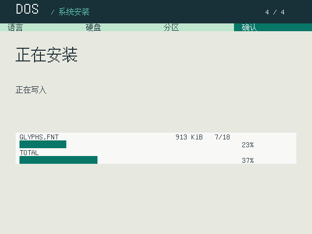
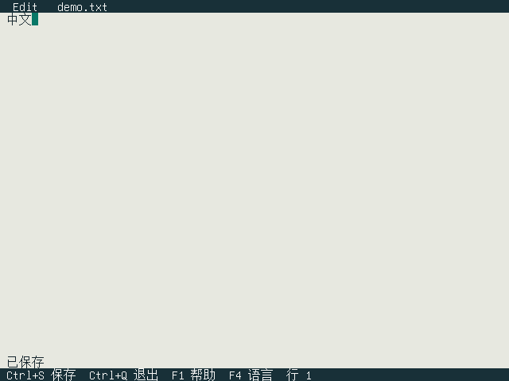

# DOS

DOS 是用 Rust 实现的操作系统。80286 和 80386 可以从同一张 BIOS 软盘启动原生 16 位内核。i686 与 x86_64 使用支持多会话的内核。在多会话内核中，按 **Alt+F1 ～ Alt+F4** 切换四个 DOS 终端。在一个终端等待键盘时，另一个终端仍可运行编译器，两者能通过 A 盘交换文件。


## 在 286 或 386 上原生启动

从同一张 FAT12 软盘启动，`IO.SYS` 检测 CPU，从 `MSDOS.SYS` 载入对应的 286 或 386 实模式内核，再执行 `COMMAND.COM` 和启动配置。COM 和 MZ 程序直接在 CPU 上执行。DOS 版本查询报告 7.10。[16 位内核入口](src/realmode.rs) · [已验证的 rust16 编译器及其构建说明](https://github.com/JamesLinYJ/rust16/tree/d4b18403c56382722f43907752d2cd80543538c1)

在已挂载的内存盘上选择一个**新**的镜像文件。以下命令构建 1.44 MB 安装软盘和 48 MiB 空白硬盘，并打开 QEMU 图形窗口。需要 QEMU、mtools、liblz4、i686-elf GCC/binutils，以及已经构建的 rust16。第一次构建时运行 `python3 scripts/prepare-cpu.py` 获取并校验固定版本的架构库。

```sh
RAM_DISK=/Volumes/DOS-INSTALL-QA
python3 scripts/realmode-image.py --toolchain ../rust16 --output "$RAM_DISK/install.img" --system-dir "$RAM_DISK/SYSTEM"
test ! -e "$RAM_DISK/new-c.img" && qemu-img create -f raw "$RAM_DISK/new-c.img" 48M
qemu-system-i386 -m 16 -boot a -drive "if=floppy,format=raw,readonly=on,file=$RAM_DISK/install.img" \
  -drive "if=ide,format=raw,file=$RAM_DISK/new-c.img"
```

需要两张发行软盘时，构建命令可改为：

```sh
python3 scripts/realmode-image.py --toolchain ../rust16 --disk-set "$RAM_DISK/DISKS"
```

从 `DISK1.IMG` 启动。只有一个软驱时，SETUP 会提示换入 `DISK2.IMG` 读取 Edit 和示例文档，再换回第一张继续。第二张也可以预先挂在另一软驱。两张盘都有发行套装标识，复制前会校验每个文件。

在提示符输入 `SETUP`，选择语言、目标硬盘、安装动作和启动配置。写入前可看到 BIOS 磁盘号、分区起止扇区和文件总量。复制页显示正在写入的文件、大小、序号和进度，再读回已安装的系统文件。安装完成后关闭 QEMU，从同一块内存硬盘启动。

```sh
qemu-system-i386 -m 16 -boot c -drive "if=ide,format=raw,file=$RAM_DISK/new-c.img"
```



- `FDISK` 可单独创建主分区。安装程序支持空盘、可用的 MBR 主分区间隙，以及已安装系统的校验和修复。写入新分区前会检查整个目标范围。在已有分区旁安装时保留原引导记录和活动分区，需从原引导管理器启动新系统。GPT 和扩展分区会给出提示。
- 安装到 C 盘时生成 `CONFIG.SYS` 和 `AUTOEXEC.BAT`。可以设置显示模式、磁盘缓存和光驱，批处理可以选择常规、精简或沿用安装介质上已有的文件。在磁盘选择页按 **L** 或 **F1** 可读 MIT 许可。[安装许可说明](docs/安装许可.md)
- 图形界面支持 CGA 640×200、EGA 640×350 和 VGA 640×480。单色文本设备使用 80×25 英文界面。图形界面的八种语言按 BCP 47 标签排列，依次为德语、英语、西班牙语、法语、日语、韩语、简体中文和繁体中文。字库按需从引导卷读取，四字节 GB18030 的显示范围取决于已收录字形。
- `SMARTDRV /STATUS` 显示写穿缓存状态，`SMARTDRV /BENCH` 比较相同访问序列的 BIOS 读取次数。独立的 B 软驱和 IDE ATAPI 光驱可从 Shell 读取。光驱支持 ISO 9660 目录与文件。[光驱驱动](boot/realmode/src/optical.rs)
- 原生 16 位内核支持 FAT16、FAT32 数据盘、8.3 路径、跨簇读写和多段 MZ 加载。文件句柄的读取位置为 32 位，当前同时支持一个可写句柄，上限 65,024 字节。`COPY` 通过独立的扇区复制路径可复制更大的文件。

DOSBox-X 的 80286 机型（30,000 cycles/ms）从启动软盘进入提示符约需 8 秒。若启动批处理先用 `TYPE WELCOME.TXT` 显示多语言文本，两次冷启动实测为 10.8 和 10.9 秒。可用下列命令测量本机耗时；串口记录和计时结果写入 `--proof` 目录。

```sh
python3 scripts/realmode-boot-time.py --image "$RAM_DISK/install.img" --ram-dir "$RAM_DISK" --proof target/boot-time --cpu 286 --window --welcome
```

### 原生 386 的扩展内存

在安装软盘或安装后的 C 盘启动，输入 `MEMSTAT` 可查看 EMS、XMS、VCPI 版本和当前空闲容量。`MEMSTAT /TEST` 同时持有三种内存块和一个 VCPI 页，写入不同数据，检查切页、读回、DOS 高端内存扩容及释放后的记账。[DOS 诊断工具](native-tools/src/bin/memstat.rs)

| 接口 | 原生 386 实现 | 已运行的独立 DOS 程序 |
| --- | --- | --- |
| LIM EMS 4.0 | D000h 的四个 16 KiB 硬件窗口，多页映射、句柄、保存和恢复映射、映射调用、区域移动及交换 | Borland `EMSTEST.COM` 写入并读回 128 页。Jemm `EMS4E`、`EMS56`、`EMS57` 验证整幅映射、跨映射调用返回和双向复制 |
| XMS 3.0 与 UMB | XMS 块、锁定、移动、调整大小、HMA 和 A20 管理。XMS 与 DOS 共用 UMB 分配器，按安装机器的 ROM 布局确定可用窗口 | `XMSTEST` 通过四种源、目标重叠关系。`XMSSTAT` 查询容量并申请、释放最大的 UMB |
| VCPI 1.0 | V86 和保护模式之间切换，换入客户端 CR3、描述符表和任务状态，保护模式入口支持查询、分配和释放 4 KiB 页 | `TESTVCPI` 在保护模式中输出 `hello from pm` 并返回 DOS。`VCPI` 在保护模式查询并分配内存，再按实际返回的物理地址释放 |

`CONFIG.SYS` 中的 `DEVICE=EMM386.SYS` 加载驱动，`DOS=UMB` 将可用高端段接入 DOS 的 MCB 链。286 使用同一张盘，跳过驱动后继续启动。传统 EMS、XMS 和 VCPI 共用的内存池上限为 32 MiB，实际容量受 BIOS 报告的内存和常驻结构占用影响。新分配的内存会清零，VCPI 只接受本接口分配的页进行释放。本次验收覆盖 DOSBox-X 和 QEMU。Jemm 的 `XMSSTAT` 可用 `INT 2Fh/4309h` 取得原生句柄和空闲区表。`MEMSTAT /TEST` 验证同一远指针在分配、调整大小、锁定及释放后能读到更新。物理 ISA DMA 到页框和第三方 XMS 管理器共存仍待验证。[Rust 驱动](boot/emm386/src/main.rs) · [安装后运行画面](docs/assets/native-386-ems.png)

在带有 PAE、PSE 和高位可用 RAM 的 CPU 上，16 位程序可通过 DOS 页句柄读写 4 GiB 以上的物理页。驱动依据 E820 和处理器地址宽度分配。标准 QEMU 验证了 4 GiB 以上的读写，另用将 RAM 放在 128 TiB 处的测试机验证了物理地址的第 47 位。安装盘带有测试程序 `MEMSTAT /HIGH`。[调用约定和复现命令](docs/dos-high-memory.md)

回归脚本会核对 Borland EMSTEST 2.0 的 SHA-256。传入上游 Jemm 源码时，脚本用宿主机 JWasm 直接编译独立测试程序，也可以用 `--clients` 指定已编译程序的目录。全部可写虚拟磁盘放在 `--ram-dir` 所指的内存卷。[验收使用的 Jemm 源码](https://github.com/Baron-von-Riedesel/Jemm/tree/89cd461f539120cbb4c37f677987e64823930cc7)

```sh
python3 scripts/realmode-ems-test.py --image "$RAM_DISK/install.img" \
  --disk1 "$RAM_DISK/DISKS/DISK1.IMG" --client /path/to/EMSTEST.COM \
  --jemm /path/to/Jemm --jwasm /path/to/jwasm \
  --ram-dir "$RAM_DISK" --proof target/native-ems
```

### 用原生 386 内核启动中文版 Windows 3.2

在装有中文版 Windows 3.2 的 FAT32 启动盘上，保留 `CONFIG.SYS` 中的 `DEVICE=EMM386.SYS`。从 DOS 提示符进入 `C:\WINDOWS`，运行 `WIN /3`。原版 WIN386 通过 `EMMXXXX0` 取得驻留驱动的 EMS 导入表，再接管保护模式和分页。按 **Alt+H**、**A** 打开程序管理器的「关于」窗口，可查看 Windows 报告的运行模式。

两次 BIOS 冷启动均显示「版本 3.2」和「386 增强方式」。i686 使用 QEMU Pentium III，x86_64 使用 QEMU64，两者均加载同一套原生 16 位 DOS 系统文件。[i686 关于画面](docs/assets/native-windows32-enhanced-i686.png) · [x86_64 关于画面](docs/assets/native-windows32-enhanced-x86_64.png)

以下回归使用已安装 Windows 的原始磁盘镜像，要求开机停在 `C:\>`、Windows 位于 `C:\WINDOWS`，并采用默认中文 VGA 桌面布局。脚本为两台机器各建一个临时内存盘写入层，先运行 `MEMSTAT /TEST`，再输入启动命令，检查窗口标题、版本和模式文字，并保存两张完整截图。

```sh
python3 scripts/realmode-win32.py --disk "$RAM_DISK/windows-installed.img" \
  --ram-dir "$RAM_DISK" --proof target/native16/windows-about
```

### DOS 上的 Microsoft Edit 移植

从安装后的 `C:\>` 输入 `EDIT` 新建文档，或输入 `EDIT NOTE.TXT` 打开文件。Edit 默认使用安装向导所选的语言。按 **F4** 可以在德语、英语、西班牙语、法语、日语、韩语、简体中文和繁体中文间切换，当前文档和撤销记录继续保留。修改系统盘 `CONFIG.SYS` 的 `LANG=` 可设置下次开机的默认语言，例如 `LANG=ja` 或 `LANG=zh-Hant`。单色文本适配器使用英文。

文本缓冲、按词移动和编辑历史参考上游 Microsoft Edit，文件、屏幕、键盘和内存由 DOS 适配。原生版本提供单文档编辑、查找、撤销和重做。上游的多文档界面和正则搜索尚未移植。[上游版本](https://github.com/microsoft/edit/tree/b7f83220868373945945e2218e852c24cbb4dcf0) · [DOS 实现](native-tools/src/editor.rs)

| 操作 | 按键 |
| --- | --- |
| 保存、另存、退出 | Ctrl+S、F2、Ctrl+Q |
| 切换界面语言、快捷键帮助 | F4、F1 |
| 查找、下一个匹配 | Ctrl+F、F3 |
| 撤销、重做、按词移动 | Ctrl+Z、Ctrl+Y、Ctrl+← / → |
| 输入汉字 | Ctrl+P 输入拼音选字，或 Ctrl+U 输入 Unicode 码位 |



[查看 Edit 的八种语言选择界面](docs/assets/edit-languages.png)

```sh
python3 scripts/realmode-test.py --toolchain ../rust16 --ram-dir "$RAM_DISK"
python3 scripts/realmode-install-test.py --image "$RAM_DISK/install.img" --ram-dir "$RAM_DISK" --disk-set "$RAM_DISK/DISKS" --proof target/native-install
python3 scripts/realmode-edit-test.py --image "$RAM_DISK/install.img" --ram-dir "$RAM_DISK" --proof target/native-edit
```

单盘回归可以省略 `--disk-set`。回归需要 DOSBox-X、QEMU、mtools 和 dosfstools。它检查 286/386 开机、CGA/EGA/Hercules/VGA 机型上的编辑保存、中文 GB18030 字节读回、44,800 字节文档、FAT32 高簇号和 100 KiB 文件复制。多核和多终端验收使用下面的 i686 和 x86_64 内核。

## 在 QEMU 里启动 i686 和 x86_64 内核

需要 Python 3、Rustup、NASM、mtools、QEMU，以及仓库指定的 Rust nightly。UEFI 启动还需要对应架构的 OVMF 固件。macOS 可用 Homebrew 安装 qemu、mtools、nasm 和 coreutils。

```sh
python3 scripts/prepare-cpu.py
python3 scripts/qemu.py --arch x86_64 --firmware uefi
python3 scripts/qemu.py --arch i686 --firmware bios
```

两条启动命令都打开 QEMU 图形窗口，默认使用四颗虚拟 CPU。两个架构均支持两种固件。Mac 键盘用 Option 代替 Alt。如需换用自己的 FAT 启动卷，将含有 DOS-RS 驻留 COMMAND.COM 的镜像通过 `--image /path/to/dos.img` 传入。每个终端先加载 CONFIG.SYS 中的设备，再执行 AUTOEXEC.BAT。

## 在提示符下试试

| 命令 | 可以看到什么 |
| --- | --- |
| `COLOR 1E`、`VER` | 黄字蓝底的系统名。本终端保留配色，`COLOR` 恢复默认。 |
| `MEM` | 查看本终端空闲的 XMS、最大连续块和可映射的 EMS 页数。若当前目录有 FreeDOS MEM，则运行磁盘上的程序。 |
| `HW` | 每颗在线 CPU 的 APIC ID、客体时间片计数和 PCI 设备。 |
| `USB`、`USB READ 7` | 连接速度、设备 ID 和 USB 大容量存储第 7 个扇区的前 32 字节。 |
| `NET`、`NET ARP 10.0.2.15 10.0.2.2` | 在挂有 e1000 的 QEMU 用户网络中，读出网卡地址并实际收发 ARP 帧。 |
| `WIFI`、`BT` | Intel 无线适配器探测信息、标准 USB 蓝牙控制器状态或缺少设备的原因。 |

## 原生 POSIX 文件和管道

i686 和 x86_64 的 Shell 可以运行内置 Rust 命令，也可以从挂载卷加载独立的静态 ELF 程序。每个管道阶段有独立的 PID、参数、描述符表和退出状态。内核在空管道上挂起读者，在满管道上挂起写者，另一端可继续运行。管道的退出状态取最后一个程序，可用 `echo $?` 查看。原生进程启动时继承 Shell 各盘的当前目录。终端收到按键后唤醒等待读入的任务，按 Ctrl+D 结束输入。一条管道等待键盘期间，仍可用 Alt+F2 切换终端运行 DOS 程序。

在含有 `a.txt` 的可写目录中输入以下命令。

```text
cat a.txt | wc -c > count.txt
type count.txt
```

`count.txt` 包含十进制字节数和一个 LF。`cat < a.txt | cat > copy.bin` 按原样复制字节。用 `cat a.txt >> copy.bin` 可以在已有文件末尾追加内容。原生程序和 DOS 通过同一套 VFS 打开文件。`unlink name.txt` 移除目录项，已经打开的描述符继续访问原文件，最后一次关闭后，文件系统可以回收存储空间。要自行验证，运行 `fdcheck probe.tmp`。它要求该文件名尚未使用，会验证删除、同名重建和共享偏移，然后清理测试文件。

磁盘上的 `.elf` 在 CPU 的用户态（Ring 3）执行。每个进程有独立的映射和 64 KiB 栈，启动 CPU 的本地 APIC 定时器能抢占纯计算循环。程序通过最小 C 运行库使用描述符、管道、64 位文件偏移和退出状态。当前 ABI 支持本架构的静态 ELF，使用固定的 2 MiB 虚拟地址窗口，所有进程合计最多驻留 2 MiB 用户页。动态链接、TLS、`fork` 和完整 POSIX 接口尚未实现。[用户态装载器](native-exec/src/lib.rs) · [C 接口](native-exec/libc/include/unistd.h)

用目标架构的 `i686-elf-gcc` 或 `x86_64-elf-gcc` 和配套 binutils 构建程序。以下示例把程序放进已有的 FAT 内存盘镜像。启动同架构内核后在提示符输入 `C:`、`HELLO.ELF 7`，可看到 `hello from native C`。

```sh
python3 scripts/prepare-cpu.py
python3 scripts/native-cc.py --arch i686 -o target/hello.elf native-exec/examples/hello.c
mcopy -o -i "$RAM_DISK/c.img" target/hello.elf ::HELLO.ELF
python3 scripts/qemu.py --arch i686 --firmware bios --ram-dir "$RAM_DISK" --c-disk "$RAM_DISK/c.img"
```

x86_64 的原生 ELF 支持低半区的 48 位规范虚拟地址。按实际装载段分配四级页表，用户栈、读写权限和不可执行页由各进程独立维护。QEMU 已从 `0x7f0000001000` 执行代码，并通过 `0x7ffffffff000` 的数据页完成跨进程管道传输。所有原生 ELF 进程合计可使用 2 MiB 驻留数据和代码页。i686 保留原有 ELF32 地址范围。[装载器和运行示例](native-exec/examples/highva.c)

`python3 scripts/qemu-native-elf.py --ram-dir "$RAM_DISK"` 会为两种架构分别编译 C 程序，从 QEMU Shell 执行 `cat.elf a.txt | wc.elf -c > count.txt`，并在退出 QEMU 后核对文件。它还检查 unlink 后的描述符、并行进程的私有内存、异常退出、时钟抢占和 DOS COM 共存。内置命令的回归入口是 `scripts/qemu-posix.py`，同样接受 `--ram-dir`。

## 文件系统

i686 和 x86_64 的 DOS Shell、INT 21h、FCB、COM/MZ 加载器和原生进程使用同一套路径解析入口和已打开文件接口。内置启动盘使用 FAT。内核在 IDE 主盘上识别裸卷、MBR 主分区和 GPT 数据分区，按分区表顺序将第一个能挂载的数据卷分配给 C 盘。GPT 的 EFI 系统分区、恢复分区和禁止自动分配盘符的分区会跳过。[卷分派](src/vfs/driver.rs) · [分区识别](storage/block/src/partition.rs)

| 格式 | 文件访问 | 已验证的范围 |
| --- | --- | --- |
| FAT12、FAT16、FAT32 | 读写，DOS 8.3 路径 | 两种内核都能跨终端打开、重命名和删除同一文件，保留旧描述符，重读复制结果并通过 `fsck.fat -n`。IDE 上的 FAT 卷当前上限为 64 MiB。 |
| Btrfs | 单设备卷读写，原生程序可用长文件名，DOS 可用能表示为 8.3 的名称 | Linux 格式化的 128 MiB 单设备卷通过 DOS 程序加载、管道、跨终端删除和冷启动。Linux 的 `btrfs check --readonly --check-data-csum` 和 `btrfs restore` 核对了数据。 |
| NTFS 3.x | 只读，按卷内 `$UpCase` 表匹配长文件名 | 读取常驻和非常驻数据、遍历 `$I30` 目录索引、运行 DOS COM。测试卷上的创建和删除被拒绝，退出后整盘 SHA-256 保持一致。 |

NTFS 驱动使用 Rust 直接读取 MFT。目前支持 512 字节逻辑扇区和基记录内可完整描述的数据流。压缩、加密和重解析点返回未支持。Windows 系统卷的独占管理员写入及日志恢复仍待实现。原生 16 位 286/386 内核使用驻留 IO.SYS 提供的 FAT 服务。[NTFS 实现](storage/ntfs/src/lib.rs) · [16 位内核](src/realmode.rs)

Btrfs 代码移植自 Antimatter Studios 维护的 Rust 驱动，DOS-RS 提供块设备、时钟与打开后删除的生命周期处理。源版本和许可证列在 NOTICE 中。[Rust 上游](https://github.com/antimatter-studios/rust-fs-btrfs/tree/bac713a69c2b65f70ef1ea0845760f92858ad88d) · [组件说明](NOTICE)

以下命令使用已挂载的内存盘。FAT 需要 dosfstools 和 mtools，NTFS 需要 `mkntfs`、`ntfscp`、`ntfscat` 和 mtools。Btrfs 需要 Linux btrfs-progs，macOS 可加 `--linux-tools-image <本地镜像名>` 使用装有这些工具的 Linux 容器。

```sh
python3 scripts/qemu-posix.py --ram-dir /path/to/ramdisk --fat 12 --fat 16 --fat 32
python3 scripts/qemu-btrfs.py --ram-dir /path/to/ramdisk
python3 scripts/qemu-ntfs.py --ram-dir /path/to/ramdisk
```

## 兼容范围

**启动和并发**　传统 BIOS 从 MBR 启动，UEFI 从系统分区加载。二者进入同一套内核服务。启动 CPU 管理设备，其他 CPU 用独立栈并行执行不同会话的解释器时间片。单 CPU 自动回退到轮转。项目自有引导和内核源码使用 Rust。底层的 MBR 入口、实模式转换、AP 启动和中断门使用固定版本的外部架构代码。[外部组件说明](NOTICE)

**i686 和 x86_64 怎样执行 16 位程序**　这两个内核使用 DOS-RS 自己的 Rust 指令解释器。每个会话有独立的寄存器、内存和设备状态。开启 `--pc386` 后，标准模式使用 Windows 的 DOSX。386 增强模式由 Windows 自己的 VMM 管理页表、保护模式任务和虚拟 8086 上下文，DOS-RS 按客体寄存器翻译地址、递交异常和中断。VGA 位平面绘图和 AT 键盘中断也由 DOS-RS 实现。宿主上的 QEMU 负责启动整台虚拟 PC。[执行器源码](src/guest/step.rs)

**DOS 程序和内存**　支持实模式 COM 和 MZ、嵌套 EXEC、MCB、每进程 JFT、共享文件偏移和驻留 DOS 驱动。每个终端有 640 KiB 常规内存，默认配 8 MiB 扩展内存。启动时可用 `--extended-mib 128` 为每个会话配置 128 MiB，直接构建可用 `DOS_RS_EXT_MIB` 指定 1～128 MiB。128 MiB 配置为高端内存区预留 64 KiB，XMS 和 EMS 共同分配余下的 131,008 KiB。XMS 支持句柄、搬移、锁定、调整大小、HMA 和 A20。DOS 与 XMS 共用 96 KiB 上位内存区（UMB），程序可通过 INT 21h 链接上位内存，CONFIG.SYS 可用 `DEVICEHIGH` 装载驱动。EMS 通过 INT 67h 提供 D000 段的四个 16 KiB 窗口、七组备用映射寄存器、跨页搬移、交换和映射调用。当前虚拟 EMS 设备没有 DMA 寄存器组。FreeDOS MEM 1.12 的 /XMS 与 /EMS 已在双架构、双固件运行。[FreeDOS MEM](https://www.ibiblio.org/pub/micro/pc-stuff/freedos/files/repositories/1.4/html/en/base/mem/20250410.0/index.html)

**显示和设备**　UEFI 用 GOP 帧缓冲绘制彩色文本，BIOS 默认用 VGA 文本模式。开启 `--pc386` 后，传统 BIOS 也可在 QEMU 标准 VGA 上使用 640×480 图形模式。两条路径都支持 DOS 字符属性和终端切换。已验证 PS/2、串口、打印、IDE 扇区读取、FreeDOS SETVER.SYS、DOS 字符及块设备、xHCI 上的 USB 2.0 高速存储，以及 Intel 82540EM 的以太网帧收发。Intel 8265、AX200 和 AX210 目前实现 PCI 探测，固件加载和联网仍待完成。蓝牙已有 USB HCI 控制命令和 LE 扫描路径，待实物验证。

## 在内存 C 盘安装中文版 Windows 3.2

以下 macOS 示例使用已挂载的内存盘 `/Volumes/DOSRS-RAM`。启动介质、UEFI 变量和可写 C 盘都放在该卷上。只需创建一次 C 盘，关闭 QEMU 后复用同一镜像即可。卸载内存盘或重启 Mac 会丢失该卷内容。

```sh
RAM_DIR=/Volumes/DOSRS-RAM
C_IMG="$RAM_DIR/dos-c.img"
qemu-img create -f raw "$C_IMG" 64M
mformat -i "$C_IMG" -v DOSRS_C ::
mmd -i "$C_IMG" ::WINSETUP
# 将原版简体中文 Windows 3.2 安装盘的文件放入本地 winsetup 目录后执行
mcopy -i "$C_IMG" winsetup/* ::WINSETUP/
python3 scripts/qemu.py --arch x86_64 --pc386 --ram-dir "$RAM_DIR" --c-disk "$C_IMG"
```

在 DOS-RS 提示符依次输入 `C:`、`CD \WINSETUP`、`SETUP.EXE`。A 盘是内置的临时启动卷，C 盘是 IDE 主盘上的裸 FAT 卷，支持 512 字节扇区，当前整卷上限为 64 MiB。普通文件支持按偏移读写，关闭文件时将改动写回镜像。安装测试不附带 Microsoft 安装介质。

原版简体中文 Windows 3.2 已在 x86_64 和 i686 DOS-RS 上分别从空白 C 盘完成安装。选择 Express Setup 并输入姓名。安装器询问如何更新 A 盘配置时，选择将建议的配置保存到 Windows 目录。打印机选“无连接的打印机”，跳过教程。看到“Windows 3.2 已安装完毕”后选择返回 MS-DOS。

关闭 QEMU，用同一条启动命令和同一块 C 盘重新开机，在 DOS-RS 提示符输入以下命令：

```dos
C:
CD \WINDOWS
WIN /3
```

i686 / 传统 BIOS 和 x86_64 / UEFI 均已用内存 C 盘冷启动。进入中文程序管理器后，按 `Alt+H`、`A` 打开“关于程序管理器”。Windows 3.2 在两台机器上均显示“386 增强方式”。[i686 截图](docs/assets/windows32-enhanced-i686.png) · [x86_64 截图](docs/assets/windows32-enhanced-x86_64.png)

运行 `WIN /S` 可启动标准模式。两个架构也已在该模式下验证 640×480、16 色 VGA、键盘和计算器。[验收记录](docs/guest-programs.md#windows-32-simplified-chinese)


## 运行回归

```sh
PROOF_DIR=target/proof-uefi scripts/qemu-smoke.sh
PROOF_DIR=target/proof-pc386 scripts/qemu-smoke.sh --pc386
DOS_RS_TEST_FIRMWARE=bios PROOF_DIR=target/proof-bios scripts/qemu-smoke.sh
python3 scripts/qemu-terminals.py
python3 scripts/qemu-terminals.py --firmware bios --output target/terminal-bios
python3 scripts/qemu-devices.py --setver /path/to/SETVER.SYS
python3 scripts/qemu-hardware.py
python3 scripts/qemu-memory.py --extended-mib 128 --mem /path/to/MEM.EXE
python3 scripts/qemu-native-gate.py --ram-dir /path/to/ramdisk
```

省略外部二进制参数即可运行仓库自带的测试。内核自测与交互启动独立。MASM、LINK、Microsoft C 等工作负载的输入和输出见[程序记录](docs/guest-programs.md)。修改模块和新增驱动的入口见[开发指南](AGENTS.md)。
